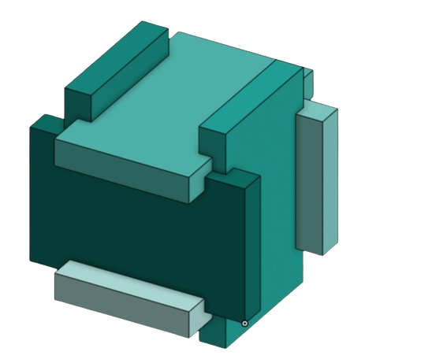
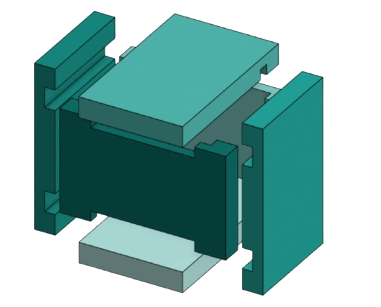

# escape

The escape is a small puzzle box containing a hidden message.

As a kid I absolutely loved puzzles of any kind but as I grew older my priorities changed and I haven't touched one since then.
So I've decided to use this opportunity to reconnect with my inner child once again by creating a puzzle box. 

## About the project

The escape contains 6 sides, which are interlocked in each other. They are put together to confuse you and trick you into doing the wrong move. 

The Goal -> Give it to a different person. They shall find the correct path for the hidden message (a small object is also possible) you wrote. 

## Process

This project turned out to be considerably more complex than I had initially imagined, especially at the beginning.  

My first step was to research the mechanisms of puzzle boxes in order to understand their construction. 
Since I wanted to create an original design, of my own, I began by sketching different ideas. After some brainstorming and lots of sketches, I eventually had a design that was the foundation of the next steps. This initial step was rather chaotic but necessary. 

Figuring out Onshape, a designing tool online, was also a bit of a challenge. After spending some time exploring, I began designing the first individual parts of the escape. 

For me, the most challenging phase was definitely determining the function of each individual piece and how the different pieces would interlock in each other. During the research phase, I wrote a potential solution path for the cube using a binary system, which I believed would be useful for the future. 

However, I didn't use it. 

The Idea of writing the rules and path in a binary system is neither ineffective nor is it advantageous. It largely depends on the puzzle and its designer. I would recommend experimenting with different methods until you find the one that best suits. For me reverse engineering proved to be the most effective method.  
 
### Next steps ... 

	- assemble it

## Do it yourself!

Here is a step by step instruction on how to assemble the escape -> [assembly](assembly/assembly_steps.md)

### Printing settings

Filament: PLA

Layer height: 0.16 mm (fine)

Wall loops: 2 

Infill: 20%

3D model format: 3MF or STL

Volume of the cube ~ 201.1939 cm³

## Tools 

For this project I am using:

	- Onshape
	- PrusaSlicer

# BOM 

| Item                  | Qty | Supplier | Cost/item | Total Cost | Link             |
|-----------------------|----:|----------|----------:|-----------:|------------------|
| THE PIECES            | 1   | 11d.ch   | $23.73    | $23.73     | https://11d.ch/  |
| Estimated total shipping | 1 |          |           | $9.08      |                  |
### Total cost : $32.81
