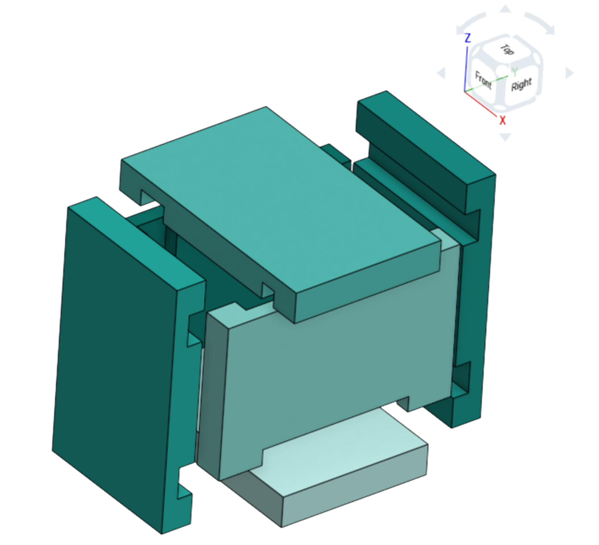
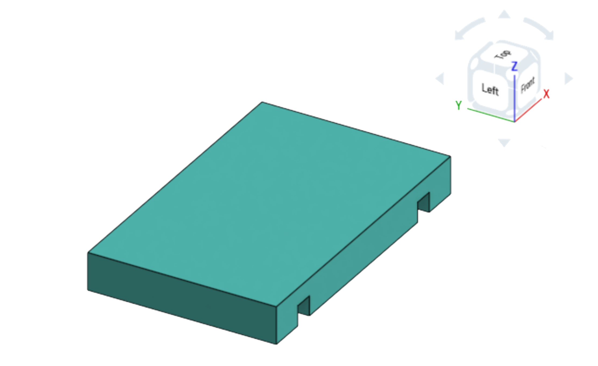
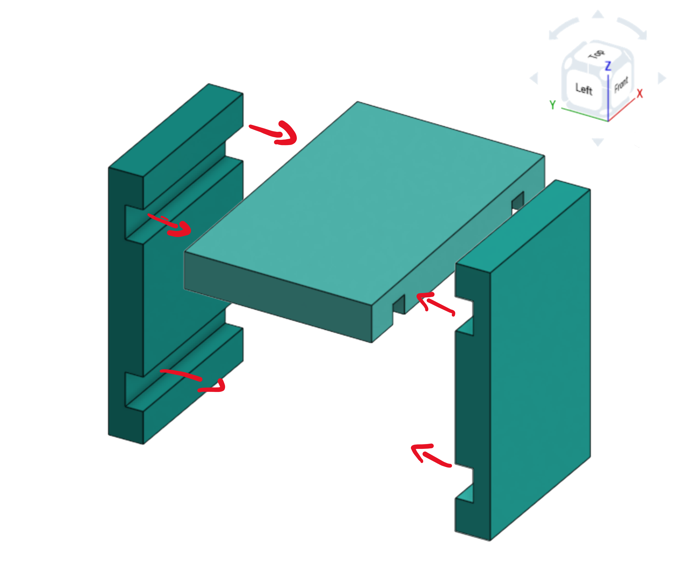
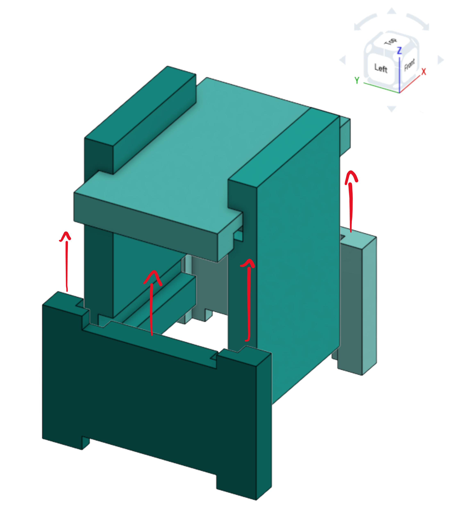
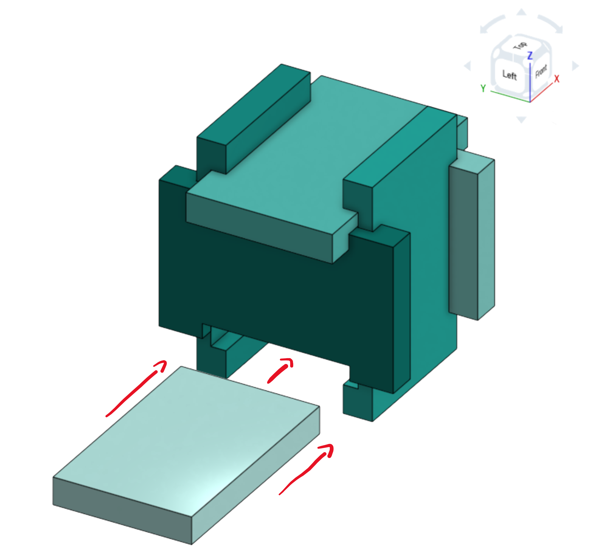

# How to assemble escape
(I would recommend to zoom out)
### preview 

### Left view

### Right view

### First step 

### Second step 

### Third step 

### Fourth step

# Solution 

for the solution you simply have to do the assembly steps backwards. 
the bottom piece should be the key piece.
